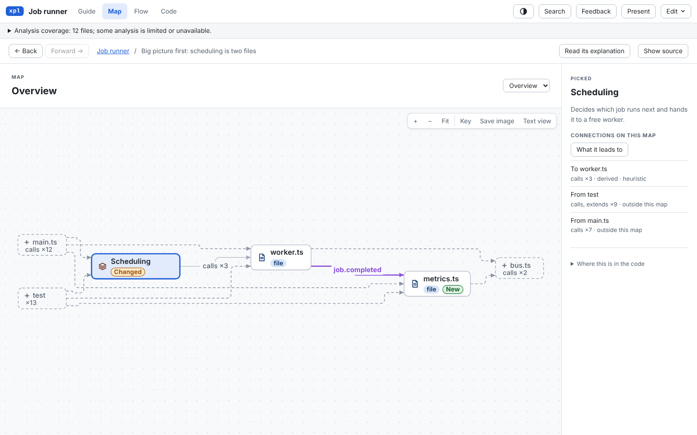

# Explain a change

Ask the skill to explain a pull request or a branch. It reads the diff locally with git and never posts
anything:

```text
/code-explainer explain change main...my-branch. Root: /work/jobs. Audience: reviewers. Question: what changes for callers and what can fail? New guide: retry-change.
```

The guide says what changes for users, where, who else is affected, and which tests cover it. The page
shows the diff, the code before the change, and which boxes are new or changed. For a pull request on GitHub,
see [GitHub pull requests](pull-requests.md).



## The commands behind it

`xpl change <guide> <base>..<head>` records the change in the guide: the base and head commits and every
changed file with its hunks, read from git. It prints the changed symbols, their direct callers and the tests
that reference them. Claims about the code before the change are checked against the base commit. The viewer
marks the changed lines, and the changed words inside a rewritten line.

`xpl draft change <guide>` drafts a tour of the change from what `xpl change` recorded. For a pull request
on GitHub, `xpl pr prepare` fetches its base and head into a separate folder first; see
[GitHub pull requests](pull-requests.md).
