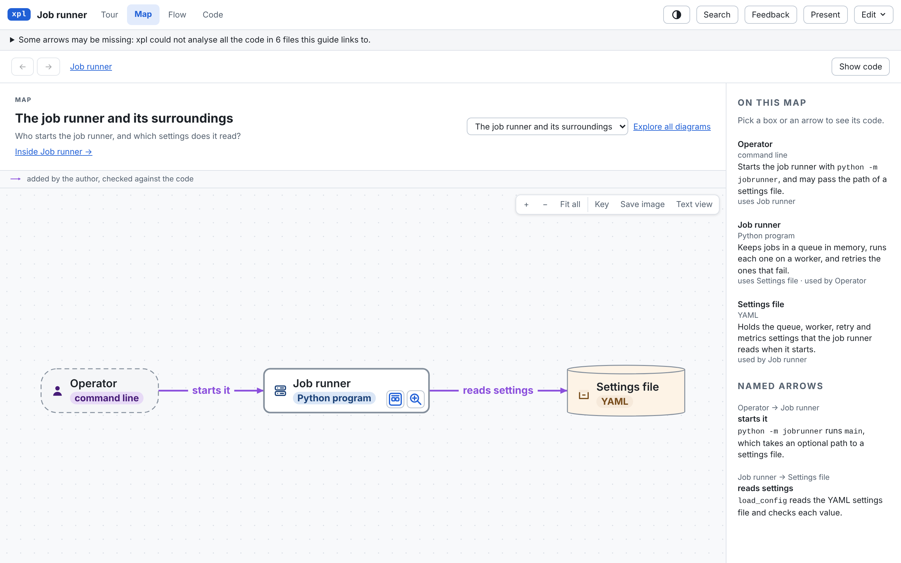

# Explain a question or a repository

Ask the skill a question about part of a project, or for an overview of the whole repository:

```text
/code-explainer explain how failed jobs are retried. Root: /work/jobs. Audience: backend engineers. New guide: job-retries.
/code-explainer explain repo. Root: /work/orders. Audience: new maintainers. Question: how do requests reach storage? New guide: orders-overview.
```

Add "quickly" for a fast answer: one diagram and a five-step tour. To add a question to a guide you already
have, say `Existing guide: <name>` instead of `New guide`. [Create a guide](../skill/create.md) explains each
choice and what to do when a run stops.

## Architecture maps

An overview of a repository goes from the top down. The first map shows the system: who uses it, the
services inside it and what they rely on, such as a database or a payments API. A box with a zoom badge
opens the map of the level below it: the parts of one service, then its code.



`xpl draft repo` drafts these maps from the index, and the agent or you write the text. Two more drafts start
from one type:

- `xpl draft class <guide> <type>` maps the classes and interfaces around one type: what it extends and
  implements, and what extends or implements it.
- `xpl draft states <guide> <type>` maps the states of a status type (an enum or a union of string literals)
  and the functions that move it from one state to another.

## Quick maps

`xpl draft map` drafts a map of every code file, one map per folder. It is for code you did not write line by
line, such as code an AI assistant wrote. Each box gets a plain name and one sentence, shown on the box. Next
to each sentence to write, the draft puts what the index knows about the file: its header comment, what it
defines and what uses it.

Run it again after the code changes. It drafts only the new files, removes the boxes of deleted files, and
keeps the text already written, also for a file that moved. When a change is recorded with `xpl change`, it
also adds a tour of the changed files that asks how each change serves what was asked.
`xpl update <guide> --since <rev>` does all of this in one run: it indexes, records the change and drafts the
map again.

## Sketches

A guide can start with a sketch: a diagram of an idea or a plan before there is code to read, or of
something that is not in one place in the code. Sketch boxes are drawn dotted, labelled "sketch" on the map
and linked to no code. xpl never checks them and never shows them as code. Replace a sketch box with a box of
code when it can point at code.

## Health check

`xpl health` lists common problems in code that nobody read line by line. Each finding has a file and a line,
a severity, why it matters and a short fix. It finds:

- keys and passwords written into the code;
- secrets in variables that are sent to the browser (`NEXT_PUBLIC_`, `VITE_`, `REACT_APP_`, `PUBLIC_`);
- committed `.env` files;
- code files over 1,000 lines;
- code files that nothing else references (a guess from the index).

It shows at most the first 4 characters of a secret. It is a quick check, not a security audit. It exits 0
with or without findings, and 1 when there is no index.
